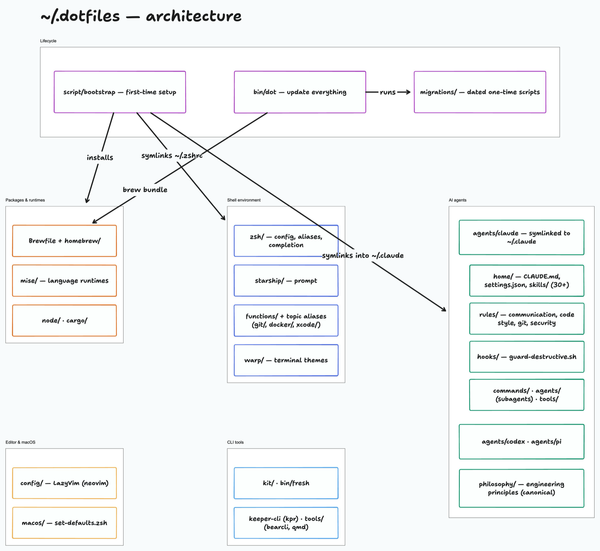

# Dotfiles 🦄 💻

> How I'm doing dotfiles.

## Architecture



Source: [`docs/dotfiles-architecture.tldraw`](docs/dotfiles-architecture.tldraw) — open with [tldraw offline](https://offline.tldraw.com).

## Setup

```zsh
git clone https://github.com/program247365/dotfiles.git ~/.dotfiles
cd ~/.dotfiles
script/bootstrap
```

On the first run, a picker asks which Brewfile entries to install on this machine. Deselected entries are remembered in `~/.config/dotfiles/brew-skip`. Run `dot --select-brews` to pick again: it offers to uninstall anything you deselect that is installed, then installs what you selected.

## Update

`~/.dotfiles/bin/dot`

## Third-party agent skills

Skills from other authors aren't committed. `agents/claude/skills.txt` lists
each one as `<owner/repo>#<commit> <name>`, and `dot` installs any that are
missing at that commit. The commit is the version you reviewed.

To upgrade a skill:

1. Review upstream's changes since the pinned commit.
2. Change the commit in `agents/claude/skills.txt`.
3. Delete `~/.claude/skills/<name>`.
4. Run `dot`.

Don't use `npx skills update`: it moves skills past their pins. To add a skill,
add a pinned line and run `dot`. More detail is in
[`agents/README.md`](agents/README.md#skills-and-subagents).

## Migrations

The `/migrations` folder contains dated scripts for one-time transitions (moving a tool to a new install method, replacing an old layout). Anything that must stay true on every machine belongs in a topic's `install.sh` instead. A migration is deleted once every machine has run it.

Migration scripts are named with the format: `YYYY-MM-DD-description.zsh`

### Running Migrations

Migrations are automatically run when you use the `dot` command. You can also run them manually:

```zsh
# Run a specific migration
~/.dotfiles/migrations/2026-10-19-agents-md-project-instructions.zsh

# Run all migrations (done automatically by dot command)
for script in ~/.dotfiles/migrations/*.zsh; do
  echo "Running migration: $(basename "$script")"
  "$script"
done
```