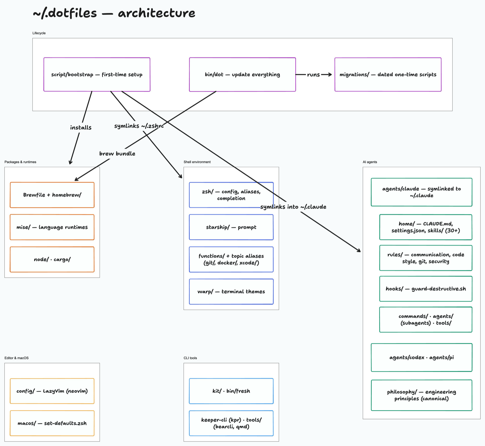

# Dotfiles 🦄 💻

> How I'm doing dotfiles.

## Architecture



Source: [`docs/dotfiles-architecture.tldraw`](docs/dotfiles-architecture.tldraw) — open with [tldraw offline](https://offline.tldraw.com).

## Setup

```zsh
git clone https://github.com/program247365/dotfiles.git ~/.dotfiles
cd ~/.dotfiles
script/bootstrap
```

On the first run, a picker asks which Brewfile entries to install on this machine. Deselected entries are remembered in `~/.config/dotfiles/brew-skip`; change your mind later with `dot --select-brews`.

## Update

`~/.dotfiles/bin/dot`

## Migrations

The `/migrations` folder contains dated scripts for handling configuration changes and updates when setting up on new machines or after major changes.

Migration scripts are named with the format: `YYYY-MM-DD-description.zsh`

### Running Migrations

Migrations are automatically run when you use the `dot` command. You can also run them manually:

```zsh
# Run a specific migration
~/.dotfiles/migrations/2025-08-20-lazyvim-setup.zsh

# Run all migrations (done automatically by dot command)
for script in ~/.dotfiles/migrations/*.zsh; do
  echo "Running migration: $(basename "$script")"
  "$script"
done
```